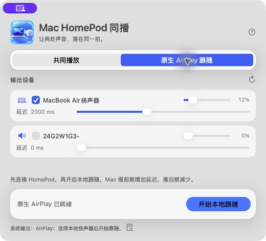

# Mac HomePod 同播

将整个 Mac 的系统声音同时输出到本地扬声器与同一局域网内的 HomePod，支持独立音量和手动同步延迟。浏览器、普通视频和本地播放器均可使用。

[下载 v0.2.1 实验版](https://github.com/kiki-2586/mac-homepod-dual-output/releases/tag/v0.2.1) · [中文使用与构建说明](README.zh-CN.md) · [更新与安装说明](RELEASE.md) · [验证记录](VALIDATION.md)

## 紧凑玻璃界面（v0.2.1）

采用520×470紧凑窗口、分段模式选择、可滚动设备卡片和动漫风 Mac＋HomePod 图标。在 macOS26 上使用原生 `NSGlassEffectView`，旧系统回退到材质背景。最小窗口480×460；音量与两种模式的延迟设置继续保留。构建仅需 Command Line Tools，无需完整 Xcode。



## 原生 AirPlay 跟随（v0.2.0 起，已包含在 v0.2.1）

先在 Mac 的 TV App／系统声音中连接 HomePod，确认原生播放正常，再选择“原生 AirPlay 跟随”，勾选本地扬声器并开始。软件保留原声，只增加延迟后的 Mac 输出，不启动 OwnTone、不重连 HomePod。停止跟随只停止本地副本；系统离开 AirPlay 输出时会停止跟随。

当前设备在 TV App 当前播放内容中，用户确认2000ms时 Mac、HomePod 和画面基本同步；这只是本机听音校准值。受保护内容及 App 内直传音频可能无法捕获。两种模式分别保存延迟。

## 共同播放（v0.1.0 及后续版本）

1. 下载 Release 中的 `MacHomePod-0.2.1-arm64.zip` 并解压，将 `.app` 放入“应用程序”。预编译版本需要 Apple Silicon、macOS 26.0 或更新版本。
2. Mac 与 HomePod 连接同一局域网；Mac 的系统声音输出保持本地扬声器。
3. 打开应用，允许系统音频录制及本地网络访问。勾选本地扬声器和 HomePod，点击“开始共同播放”。
4. 用节拍素材微调 Mac 延迟：Mac 提前则增加，Mac 落后则减少。设置会自动保存。

共同播放模式在本次验证机器上1250ms时主观基本同步；这个值不是所有设备的通用值。此模式自行连接 HomePod，视频画面不会自动补偿，受保护媒体可能无法捕获。

当前应用为 **ad-hoc 签名、未经 Apple 公证的实验版本**，下载后可能被 Gatekeeper 拦截。可以优先从源码构建；不要关闭系统安全保护。详见[发布说明](RELEASE.md)。

## 工作方式

共同播放模式：

```text
整个 Mac 的系统音频（排除程序自身）
  ├─ 内存延迟缓冲 → 本地扬声器
  └─ 后台转换为48kHz PCM16 → 本地FIFO → 独立OwnTone进程 → HomePod
```

原生跟随模式：

```text
TV／系统 → 原生 AirPlay → HomePod（保留原有音画补偿）
  └─ 不静音的系统音频 tap（排除自身）→ 内存延迟缓冲 → Mac 扬声器
```

无需虚拟声卡，运行时不需要 Homebrew 或管理员权限。程序不保存录音，不设置开机自启，不更改默认音频设备；管理 API 仅监听 `127.0.0.1:3689`。

## 从源码构建

需要 Apple Silicon Mac、Xcode Command Line Tools；构建后端还需要 Homebrew。

```sh
git clone https://github.com/kiki-2586/mac-homepod-dual-output.git
cd mac-homepod-dual-output
bash scripts/prepare-backend.sh
bash scripts/build-app.sh
open dist/MacHomePod.app
```

仅构建 Swift 界面可以直接执行 `bash scripts/build-app.sh`；共同播放模式连接 HomePod 需要先构建后端，原生跟随模式不需要后端。源码平台下限为 macOS15；发布包携带的运行库要求 macOS26。

```sh
bash scripts/test.sh
```

音频设备和真实听音测试不由 CI 代替。CI 验证 Swift 应用构建与自动回归；后端构建及额外回归步骤见[贡献指南](CONTRIBUTING.md)。

## 开源与来源

Swift 应用使用 [MIT License](LICENSE)，基于 [TechJuicelab/HomeSounds Sync](https://github.com/techjuicelab/homesounds-sync) 固定提交修改，保留原作者署名。全系统捕获、中文界面、格式转换、独立后端管理与兼容性修复见本仓库源码。

[OwnTone](https://github.com/owntone/owntone-server) 作为独立进程运行，使用 GPL-2.0；本地补丁位于 `patches/`。FFmpeg 和其他运行库分别遵循各自许可证。Release 同时提供对应源码包，包含固定源码、校验值、Homebrew 配方和许可证，详见 [THIRD_PARTY_NOTICES.md](THIRD_PARTY_NOTICES.md) 与 [UPSTREAM.md](UPSTREAM.md)。

## English

Play ordinary Mac system audio on local speakers and HomePod simultaneously, with per-device volume and manual delay adjustment. The app uses a Core Audio process tap, in-memory local delay, and a separate bundled OwnTone AirPlay sender. No virtual audio driver or login service is installed.

Version 0.2.1 includes native AirPlay follow mode: leave TV/system AirPlay connected and replay an unmuted system tap on delayed local speakers. It does not start OwnTone or take over HomePod. Delays are stored separately by mode; protected media and direct in-app AirPlay may not be capturable. The update also adds a compact native Liquid Glass interface and an illustrated app icon.

The prebuilt experimental app requires Apple Silicon and macOS26+. It is ad-hoc signed and not notarized. AirPlay latency is expected; video timing is not adjusted automatically. See the Chinese guide for setup and the validation report for tested devices and untested cases.
